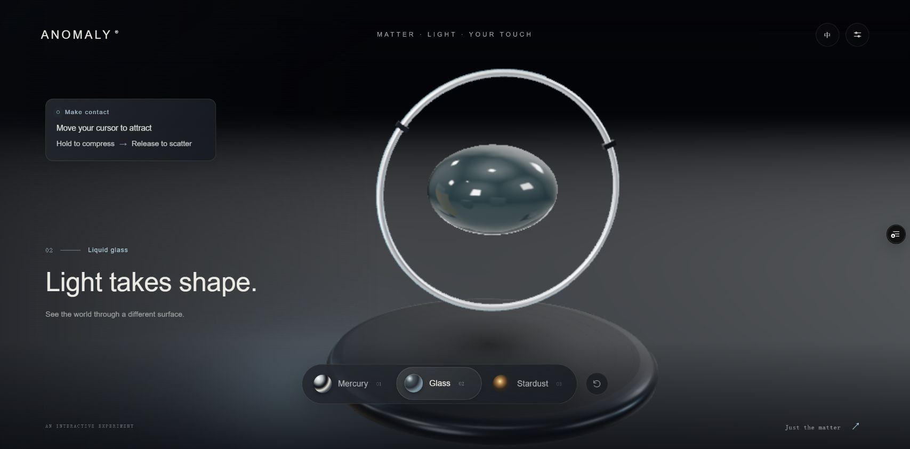

# ANOMALY

A small fluid experiment by **Newton Quan**.

[Live demo](https://anomaly-matter-lab.vercel.app) · Desktop browser · English / 中文



Move the cursor to attract the fluid. Hold to gather it, then release to scatter. Switch between mercury, glass and stardust.

## Run locally

```sh
npm ci
npm run dev
```

Build with `npm run build`. Run the interaction checks with `npm run check`.

## Credits

Built with [Three.js](https://threejs.org/) and adapted from Daniel Greenheck’s [Three.js Particle Fluids](https://github.com/dgreenheck/threejs-particle-fluids), both MIT licensed. Fluid simulation is based on [Position Based Fluids](https://blog.mmacklin.com/project/pbf/) by Miles Macklin and Matthias Müller. License notices are in `public/licenses/`.
